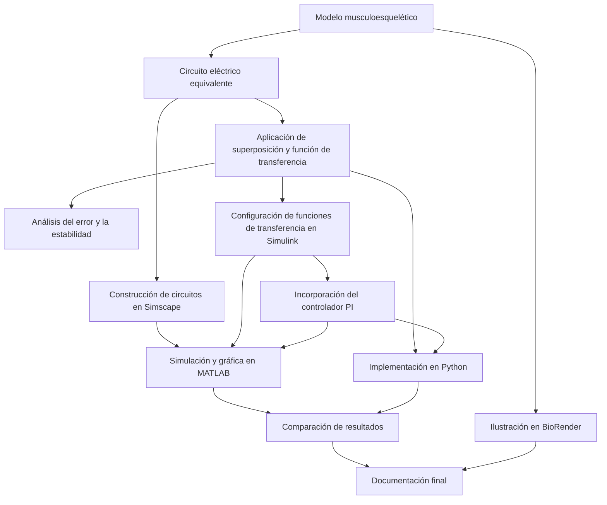

# Práctica 3: Sistema Musculoesquelético

Repositorio académico de la asignatura **Modelado de Sistemas Fisiológicos**, correspondiente al programa de **Ingeniería Biomédica** del Tecnológico Nacional de México / Instituto Tecnológico de Tijuana.

Esta práctica aborda el modelado matemático y la simulación computacional de un sistema musculoesquelético, integrando herramientas de análisis matemático, programación y modelado fisiológico. Se emplean MATLAB y Python para desarrollar y comparar los modelos correspondientes, así como recursos gráficos para representar los elementos y características del sistema estudiado.

El propósito es comprender el comportamiento dinámico del sistema musculoesquelético mediante su representación matemática, analizar los parámetros involucrados y estudiar las respuestas obtenidas a través de las simulaciones computacionales.

---

## Información del estudiante

**Estudiante:** Diego Macias Armenta  
**Número de control:** 23212212  
**Correo institucional:** l23212212@tectijuana.edu.mx  
**Docente:** Dr. Paul Antonio Valle Trujillo  
**Correo del docente:** paul.valle@tectijuana.edu.mx  
**Asignatura:** Modelado de Sistemas Fisiológicos  
**Programa:** Ingeniería Biomédica  
**Departamento:** Ingeniería Eléctrica y Electrónica  
**Institución:** Tecnológico Nacional de México / Instituto Tecnológico de Tijuana

---

## Contenido

1. [Resumen](#resumen)
2. [Competencia y objetivos](#objetivos)
3. [Relación con el temario](#temario)
4. [Representación mecánica y significado fisiológico](#modelo)
5. [Valores de los parámetros](#parametros)
6. [Análisis matemático por superposición](#matematicas)
7. [Cálculo del error en estado estable](#error)
8. [Evaluación de la estabilidad en lazo abierto](#estabilidad)
9. [Modelo en Simulink y Simscape](#simulink)
10. [Ejecución mediante MATLAB](#matlab)
11. [Diseño y ajuste del controlador PI](#pi)
12. [Interpretación de las gráficas de MATLAB](#resultados)
13. [Desarrollo complementario en Python](#python)
14. [Representación biológica en BioRender](#biorender)
15. [Discusión final](#conclusiones)
16. [Secuencia de trabajo](#flujo)
17. [Materiales y formatos de entrega](#archivos)
18. [Requisitos para reproducir la práctica](#reproduccion)
19. [Fuentes consultadas](#referencias)

---

## 1. Resumen

La práctica tiene como finalidad estudiar el comportamiento de un sistema musculoesquelético mediante herramientas de modelado matemático y simulación computacional. Para ello, se utilizan los conocimientos de la asignatura Modelado de Sistemas Fisiológicos, relacionando los principios matemáticos con la representación y el análisis de sistemas biológicos.

El desarrollo contempla el análisis matemático del modelo, la identificación de sus parámetros y la implementación de simulaciones utilizando MATLAB y Python. Ambas herramientas permiten observar el comportamiento del sistema, modificar sus parámetros y analizar las respuestas obtenidas bajo las condiciones establecidas en los casos de estudio.

Asimismo, se incorporan recursos gráficos para complementar la interpretación fisiológica del modelo y facilitar la comprensión de los elementos que conforman el sistema musculoesquelético.

**Palabras clave:** sistema musculoesquelético; modelado fisiológico; análisis matemático; simulación computacional; MATLAB; Python; Ingeniería Biomédica.

---

## 2. Competencia y objetivos

### Competencia a desarrollar

Aplicar herramientas de modelado matemático y simulación computacional para representar y analizar sistemas fisiológicos, relacionando sus parámetros y comportamiento dinámico con los principios fundamentales de la Ingeniería Biomédica.

### Objetivo general

Desarrollar y analizar un modelo matemático de un sistema musculoesquelético mediante herramientas computacionales, utilizando MATLAB y Python para estudiar su comportamiento y evaluar la influencia de los parámetros involucrados en su representación.

### Objetivos específicos

- Identificar los elementos y características fisiológicas del sistema musculoesquelético estudiado.
- Comprender los fundamentos matemáticos empleados para representar el sistema.
- Analizar los parámetros que intervienen en el modelo y su influencia sobre el comportamiento dinámico.
- Implementar el modelo matemático utilizando MATLAB.
- Reproducir el caso de estudio mediante programación en Python.
- Comparar los resultados obtenidos en ambas herramientas computacionales.
- Interpretar las respuestas de las simulaciones desde una perspectiva fisiológica y matemática.
- Documentar los procedimientos, resultados y recursos utilizados durante el desarrollo de la práctica.

---

## 3. Relación con el temario

La práctica integra conocimientos de modelado matemático, análisis de sistemas fisiológicos y herramientas computacionales, permitiendo aplicar los fundamentos de Ingeniería de Control y simulación al estudio del sistema musculoesquelético.

| Área de conocimiento | Aplicación en la práctica |
|---|---|
| Modelado matemático | Representación del comportamiento del sistema musculoesquelético. |
| Análisis matemático | Estudio de las ecuaciones y parámetros del modelo. |
| Sistemas fisiológicos | Interpretación de los elementos y variables biológicas involucradas. |
| MATLAB | Implementación y simulación del modelo matemático. |
| Python | Desarrollo de una implementación computacional alternativa. |
| Análisis de resultados | Comparación e interpretación de las respuestas obtenidas. |

---

## 4. Modelo mecánico y analogía eléctrica

### Modelo mecánico

El esquema mecánico utilizado es una aproximación que agrupa las características activas, viscosas y elásticas del sistema musculoesquelético.

| Elemento | Interpretación dentro del modelo |
|---|---|
| $F_0(t)$ | Fuerza producida por el componente contráctil activo |
| $F(t)$ | Fuerza aplicada como señal de entrada para el análisis |
| $R$ | Representación del amortiguamiento viscoso del tejido |
| $C_p$ | Compliancia del elemento elástico en paralelo, relacionada de forma simplificada con estructuras musculares pasivas |
| $C_s$ | Compliancia del elemento elástico en serie, asociada de manera aproximada con el tendón y otras estructuras en serie |
| $x(t)$ | Desplazamiento global del sistema mecánico |
| $x_1(t)$ | Desplazamiento del elemento elástico conectado en serie |

La fuerza activa se relaciona con la fuerza de entrada por medio de la expresión:

$$
F_0(t)=\alpha F(t),\qquad \alpha=0.25.
$$

La deformación que experimenta el amortiguador se expresa como $x(t)-x_1(t)$. En consecuencia, su velocidad relativa se obtiene derivando esa diferencia con respecto al tiempo.

**Variable de salida considerada:** tanto el análisis como los recursos computacionales de esta práctica utilizan $F_s(t)$ como salida. En el circuito equivalente, esta variable corresponde al voltaje medido en el capacitor $C_p$. Por esta razón, la función de transferencia estudiada es $F_s(s)/F(s)$ y las gráficas presentan unidades de voltios. Aunque los desplazamientos se emplean para interpretar el esquema mecánico, no son la señal que se grafica directamente en los resultados entregados.

### Analogía fuerza–voltaje

| Sistema mecánico | Equivalente eléctrico |
|---|---|
| Fuerza | Voltaje |
| Velocidad | Corriente |
| Desplazamiento | Carga eléctrica |
| Amortiguamiento viscoso | Resistencia |
| Compliancia | Capacitancia |

Esta analogía permite conservar la estructura matemática del sistema al representarlo mediante un circuito. Sin embargo, para convertir los valores eléctricos en magnitudes fisiológicas se necesitarían factores de escala, por lo que no deben tomarse como conversiones directas.

### Estructura del circuito

La conexión analizada se compone de los siguientes elementos:

- Una fuente de entrada $F(t)$ conectada entre el nodo superior del circuito y tierra.
- Una rama en la que la fuente $F_0(t)$ está conectada en serie con la resistencia $R$.
- El capacitor $C_s$, dispuesto en paralelo con dicha rama y conectado entre el nodo de entrada y el nodo de salida.
- El capacitor $C_p$, conectado desde el nodo de salida hasta tierra.
- La señal de salida $F_s(t)$, medida como el voltaje presente en $C_p$ con respecto a tierra.

Se conserva la polaridad asignada a la fuente $F_0(t)$ en el circuito original. Debido a esa orientación, su aportación aparece con signo negativo al aplicar el principio de superposición.

---

## 5. Parámetros del circuito equivalente

| Parámetro | Control: individuo sano | Caso: atrofia muscular simulada |
|---|---:|---:|
| Amplitud de la señal de entrada | 1 V | 1 V |
| $\alpha$ | 0.25 | 0.25 |
| $C_s$ | 10 µF | 10 µF |
| $C_p$ | 100 µF | 100 µF |
| $R$ | 100 Ω | 10 kΩ |

El valor de resistencia asignado al caso es cien veces superior al utilizado en el control. Este cambio altera la velocidad de respuesta del modelo, pero no modifica su ganancia en estado estable, tal como se comprueba en el análisis matemático.

[Volver al contenido](#contenido)

---

## 6. Análisis matemático

Para obtener la respuesta total se calcula primero el efecto de cada fuente por separado y, al finalizar, se incorpora la relación $F_0=\alpha F$.

### Primera aportación: fuente $F(t)$

Para aislar el efecto de la fuente $F(t)$, la fuente $F_0(t)$ se reemplaza por un cortocircuito. De esta manera, $R$ y $C_s$ quedan conectados en paralelo entre los nodos de entrada y salida. Al aplicar la ley de corrientes en el nodo de salida se obtiene:

$$
C_p\frac{dF_{s1}}{dt}
=C_s\frac{d(F-F_{s1})}{dt}+\frac{F-F_{s1}}{R}.
$$

Considerando condiciones iniciales iguales a cero y aplicando la transformada de Laplace, resulta:

$$
\left[R(C_p+C_s)s+1\right]F_{s1}(s)
=\left[RC_s s+1\right]F(s).
$$

Por consiguiente, la primera contribución queda expresada como:

$$
F_{s1}(s)=\frac{RC_s s+1}{R(C_p+C_s)s+1}F(s).
$$

### Segunda aportación: fuente $F_0(t)$

En el segundo análisis se sustituye la fuente $F(t)$ por un cortocircuito. Bajo esta condición, los dos capacitores quedan en paralelo y su capacitancia equivalente se calcula mediante:

$$
C_{eq}=C_p+C_s.
$$

Tomando en cuenta la polaridad definida para la fuente, se obtiene:

$$
F_{s2}(s)=-\frac{1}{R(C_p+C_s)s+1}F_0(s).
$$

A continuación, se utiliza la relación $F_0(s)=\alpha F(s)$ para expresar esta contribución en función de la entrada:

$$
F_{s2}(s)=-\frac{\alpha}{R(C_p+C_s)s+1}F(s).
$$

El método permite estudiar por separado las dos excitaciones y después combinar sus efectos. En el circuito completo, las fuentes actúan al mismo tiempo y se mantiene la relación $F_0=\alpha F$.

### Función de transferencia resultante

La salida total se calcula sumando las dos contribuciones:

$$
F_s(s)=F_{s1}(s)+F_{s2}(s),
$$

por lo que la función de transferencia queda:

$$
\boxed{G(s)=\frac{F_s(s)}{F(s)}
=\frac{RC_s s+1-\alpha}{R(C_p+C_s)s+1}.}
$$

Al sustituir los valores de cada escenario se obtienen las siguientes expresiones:

| Condición | Función de transferencia |
|---|---|
| Control | $G_{control}(s)=\dfrac{0.001s+0.75}{0.011s+1}$ |
| Caso | $G_{caso}(s)=\dfrac{0.1s+0.75}{1.1s+1}$ |

---

## 7. Cálculo del error en estado estable

El error entre la entrada y la salida se evaluó para una entrada de tipo **escalón unitario**. Para ello se aplicó el teorema del valor final:

$$
e_{ss}=\lim_{s\to0}s\frac{1}{s}\left[1-G(s)\right].
$$

La ganancia del sistema cuando $s$ tiende a cero es:

$$
G(0)=1-\alpha=0.75,
$$

por lo tanto, el error estacionario resulta:

$$
\boxed{e_{ss}=\alpha=0.25.}
$$

Cuando se mantiene un escalón de 1 V, la salida alcanza 0.75 V y la diferencia entre la entrada y la salida es de 0.25 V. El resultado es idéntico en control y caso, ya que la resistencia $R$ no interviene en el valor de la ganancia estática.

Este cálculo corresponde a una entrada escalón mantenida y no debe confundirse con la simulación gráfica, que utiliza un pulso de duración limitada. Tampoco representa el error del lazo con PI, pues en ese caso se compara la respuesta del control con la respuesta del caso controlado.

---

## 8. Evaluación de la estabilidad en lazo abierto

Para localizar el polo del sistema se iguala a cero el denominador de la función de transferencia:

$$
R(C_p+C_s)s+1=0,
$$

y se despeja:

$$
\boxed{\lambda=-\frac{1}{R(C_p+C_s)}.}
$$

| Condición | Constante de tiempo $\tau=R(C_p+C_s)$ | Polo | Estabilidad |
|---|---:|---:|---|
| Control | 0.011 s | $-90.9091\ \mathrm{s}^{-1}$ | Estable |
| Caso | 1.1 s | $-0.9091\ \mathrm{s}^{-1}$ | Estable |

Los dos polos son números reales negativos, de modo que ambos modelos son estables en lazo abierto. El incremento de la resistencia hace que el polo se acerque al origen y que la constante de tiempo sea cien veces mayor. Por ello, el escenario del caso presenta una evolución más lenta, aunque su ganancia estática sigue siendo la misma que la del control.

---

## 9. Modelo en Simulink y Simscape

Dentro del archivo **[Practica3.slx]** se encuentran los subsistemas **Control** y **Caso**.

| Subsistema | Elementos incluidos |
|---|---|
| Control | Circuito equivalente construido en Simscape Electrical y función de transferencia del individuo sano |
| Caso | Circuito equivalente en Simscape Electrical, función de transferencia en lazo abierto y una rama que integra el controlador PI con la planta del caso |

En los circuitos se utilizan fuentes de voltaje controladas, una resistencia, capacitores, un sensor de voltaje, una referencia eléctrica y bloques que permiten intercambiar señales entre Simulink y el entorno de señales físicas. La fuente $F_0(t)$ se genera a partir de la entrada aplicando una ganancia de 0.25.

Los bloques Scope sirven para observar las salidas tanto del circuito equivalente como de las funciones de transferencia. De esta manera, el modelo permite trabajar con ambas representaciones, mientras que la deducción mediante ecuaciones se conserva en el documento de análisis matemático.

### Señal de entrada empleada en la simulación

Aunque el cuaderno de MATLAB identifica el apartado como «Respuesta al impulso unitario», la señal configurada en el modelo y representada en la gráfica corresponde realmente a un **pulso rectangular**:

$$
F(t)=u(t-1)-u(t-2).
$$

| Configuración | Valor |
|---|---:|
| Amplitud | 1 V |
| Periodo del generador | 10 s |
| Duración del pulso | 10 % del periodo, equivalente a 1 s |
| Retardo inicial | 1 s |
| Rango de tiempo representado | 0 a 10 s |

Por lo tanto, dentro del intervalo observado la entrada vale 1 V desde el segundo 1 hasta el segundo 2. El área del pulso es de 1 V·s. Sin embargo, como se trata de una señal de duración finita, no equivale exactamente a un impulso ideal de Dirac. La simulación en Python debe utilizar el mismo pulso para que las comparaciones sean consistentes.

---

## 10. Ejecución mediante MATLAB

MATLAB se utiliza como herramienta para desarrollar y ejecutar el modelo matemático correspondiente al sistema musculoesquelético.

El archivo principal de esta implementación es:

**`Macias23212212.mlx`**

Este cuaderno permite organizar el desarrollo de la práctica, ejecutar los procedimientos matemáticos y presentar los resultados obtenidos.

La versión exportada del trabajo se encuentra disponible en:

**`Macias23212212.pdf`**

El documento PDF permite consultar el desarrollo y los resultados sin necesidad de ejecutar directamente el archivo de MATLAB.

### Actividades realizadas

1. Definición de los parámetros y variables del modelo.
2. Implementación de las expresiones matemáticas.
3. Ejecución de los procedimientos de simulación.
4. Obtención de resultados gráficos y numéricos.
5. Análisis del comportamiento del sistema.

---
## 11. Diseño y ajuste del controlador PI

El bloque de control identificado como `PI Controller` se encuentra configurado para funcionar como un controlador **PI** de tiempo continuo y estructura paralela. No se aplica la acción derivativa.

La respuesta de la condición sana se establece como referencia para el sistema controlado. De esta manera, la señal de error se define como:

$$
e(t)=F_{s,control}(t)-F_{s,PI}(t).
$$

La expresión general del controlador es:

$$
K(s)=k_P+\frac{k_I}{s}.
$$

La función de transferencia que relaciona la referencia con la salida del caso en lazo cerrado es:

$$
T(s)=\frac{K(s)G_{caso}(s)}{1+K(s)G_{caso}(s)}.
$$

Por su parte, la respuesta controlada respecto a la entrada original se expresa como:

$$
F_{s,PI}(s)=T(s)G_{control}(s)F(s).
$$

### Ganancias registradas

Los valores que aparecen en la captura del sintonizador y los que están guardados en el modelo presentan una pequeña diferencia:

| Parámetro | Captura de PID Tuner | Valor almacenado en el modelo de Simulink |
|---|---:|---:|
| $k_P$ | 0.21435 | 0.213191204829284 |
| $k_I$ | 3717.1212 | 3737.3541590977 |
| $k_D$ | No aplica | 0 |
| Tipo de controlador | PI | PI |

### Indicadores mostrados por PID Tuner

| Indicador | Valor observado en la captura |
|---|---:|
| Tiempo de subida | 0.00628 s |
| Tiempo de establecimiento | 0.00997 s |
| Sobreimpulso | 1.69 % |
| Valor pico | 1.02 |
| Margen de fase | 90° a 338 rad/s |
| Estabilidad del sistema en lazo cerrado | Estable |

Los indicadores anteriores corresponden a la **respuesta ante un escalón evaluada por PID Tuner**. No son mediciones tomadas directamente de la gráfica completa en la que se aplica el pulso rectangular.

---

## 12. Desarrollo complementario en Python

Python se utiliza como herramienta complementaria para reproducir y analizar el caso de estudio.

El archivo correspondiente es:

**`Practica_3.py`**

Mediante este programa se desarrolla la implementación computacional del modelo, utilizando los parámetros y condiciones establecidos para la práctica.

El documento **Caso_python.pdf** contiene el material de referencia relacionado con esta implementación.

### Actividades realizadas

1. Definición de las variables y parámetros.
2. Implementación del modelo matemático.
3. Ejecución de las simulaciones.
4. Generación de representaciones gráficas.
5. Análisis de los resultados obtenidos.

La implementación en Python permite disponer de una segunda herramienta para verificar y comparar los resultados obtenidos mediante MATLAB.

---

## 13. Representación biológica en BioRender

La siguiente ilustración, elaborada en BioRender, representa el sistema musculoesquelético y su analogía mecánica. En ella se identifican los componentes contráctiles y elásticos del músculo, así como los elementos viscosos y los desplazamientos involucrados en el modelo matemático.

**Figura 1.** Representación del sistema musculoesquelético y su modelo mecánico equivalente. Elaboración propia mediante BioRender.

La ilustración permite relacionar los elementos físicos del sistema musculoesquelético con los componentes que aparecen en el modelo matemático.

| Estructura o característica fisiológica | Elemento del modelo |
|---|---|
| Componente contráctil del músculo | $F_0(t)$ |
| Tejidos musculares pasivos con comportamiento elástico | $C_p$ |
| Tendón y elasticidad representada en serie | $C_s$ |
| Propiedad viscosa del tejido | $R$ |
| Fuerza aplicada al modelo | $F(t)$ |
| Desplazamientos mecánicos | $x(t)$ y $x_1(t)$ |

La ilustración permite distinguir los desplazamientos mecánicos de la salida eléctrica $F_s(t)$, que es la variable empleada en los cálculos y las gráficas.

## 14. Discusión final

Al aplicar superposición fue posible separar los efectos de las dos fuentes del circuito y obtener la función de transferencia global. Los resultados algebraicos corresponden a los coeficientes que se configuraron en los bloques de función de transferencia de Simulink.

Los dos escenarios son estables en lazo abierto, ya que sus polos se encuentran en el semiplano real negativo. Al modificar la resistencia de 100 Ω a 10 kΩ, la constante de tiempo pasa de 0.011 s a 1.1 s. En consecuencia, la respuesta del caso es más lenta que la del control. A pesar de esta diferencia dinámica, ambos mantienen una ganancia estática de 0.75 y un error de 0.25 ante un escalón unitario.

En la gráfica generada con MATLAB se distinguen las diferencias entre las respuestas y se observa que el controlador PI permite que la salida del caso se aproxime a la respuesta del individuo sano. El seguimiento mejora durante el pulso y el retorno después de retirar la entrada también se acerca al comportamiento de referencia.

Para que la comparación con Python sea reproducible, se deben mantener la misma señal de entrada, las mismas funciones de transferencia y las mismas ganancias del PI. Antes de considerar definitiva la simulación, es necesario elegir una de las configuraciones de ganancias registradas y utilizarla en ambas plataformas.

Finalmente, debe recordarse que el modelo agrupa y simplifica las propiedades de los tejidos. En consecuencia, los resultados describen el funcionamiento de la representación matemática simulada y no demuestran la eficacia clínica de un tratamiento contra la atrofia muscular.

---

## 15. Secuencia de trabajo

## 16. Requisitos para reproducir la práctica

### Programas y recursos necesarios

- MATLAB y Simulink.
- Simscape y los componentes eléctricos requeridos por el circuito.
- Las herramientas de ajuste de controladores necesarias para abrir y utilizar PID Tuner.
- Python y las bibliotecas que se importen en la versión definitiva del programa.
- BioRender o, en su defecto, la imagen exportada del diagrama biológico.

### Pasos de ejecución

1. Obtener los materiales que integran el repositorio.
2. Colocar el modelo de Simulink (`.slx`) y el cuaderno de MATLAB (`.mlx`) dentro de la misma carpeta de trabajo.
3. Abrir el cuaderno y comprobar los datos definidos para la simulación.
4. Revisar que los parámetros de control y caso coincidan con los valores presentados en este documento.
5. Confirmar qué conjunto de ganancias PI se utilizará en la reproducción.
6. Ejecutar el cuaderno. Durante este proceso se abrirá el modelo de Simulink y se realizará una simulación de 10 s con el solucionador `ode15s` y un paso máximo de $10^{-3}$ s. Cuando el cuaderno solicite el modelo, indicar el nombre base correspondiente al archivo `.slx` disponible.
7. Comprobar que se hayan generado las variables `X.t`, `X.F`, `X.Fsx`, `X.Fsy` y `X.PID`.
8. Crear la gráfica con la función `plotsignals` y exportarla como documento PDF.
9. Ejecutar el programa de Python con el mismo pulso, los mismos parámetros y las ganancias PI seleccionadas. Guardar la figura producida.
10. Comparar las gráficas de ambas plataformas y añadir al repositorio la ilustración de BioRender y las evidencias restantes.

---

## 17. Fuentes consultadas

Las siguientes referencias corresponden al material bibliográfico señalado en el instructivo de la práctica:

1. M. C. Khoo, *Physiological Control Systems: Analysis, Simulation, and Estimation*, 2nd ed., IEEE Press, 2018.
2. F. C. Hoppensteadt y C. S. Peskin, *Modeling and Simulation in Medicine and the Life Sciences*, Springer.
3. J. E. Hall, *Guyton and Hall Textbook of Medical Physiology*, 14th ed., Elsevier, 2021.
4. K. Ogata, *Ingeniería de Control Moderna*, 5.ª ed., Pearson Educación, 2010.
5. N. S. Nise, *Control Systems Engineering*, 8th ed., John Wiley & Sons, 2020.
6. P. A. Valle, *Syllabus para Modelado de Sistemas Fisiológicos*, Tecnológico Nacional de México / Instituto Tecnológico de Tijuana, Tijuana, B. C., México, 2026. Sección 5.5: «Práctica: Modelado y control del sistema musculoesquelético».
7. Tecnológico Nacional de México, *Programa de estudio de la asignatura Modelado de Sistemas Fisiológicos, IBF-1020*.

---

## Uso académico

Este repositorio contiene la documentación de la **Práctica 3** de la asignatura Modelado de Sistemas Fisiológicos. El material integra el desarrollo matemático, la simulación del circuito eléctrico equivalente, la comparación de las condiciones de control y caso, y la evaluación de un controlador PI mediante herramientas computacionales.
